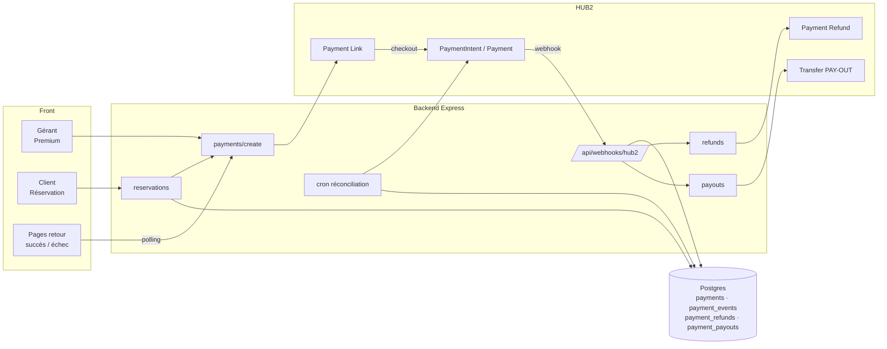
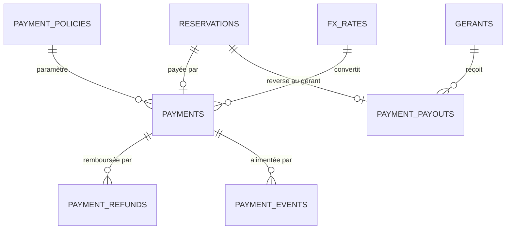
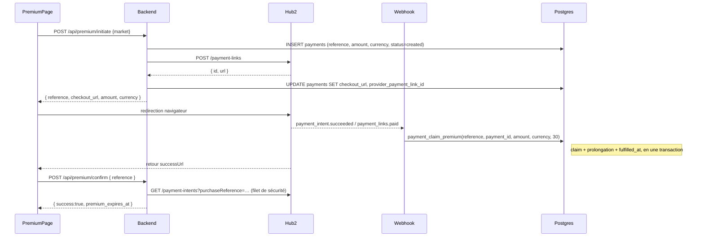
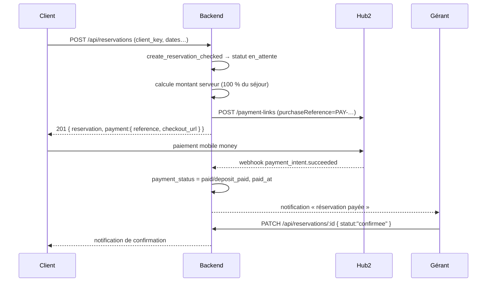
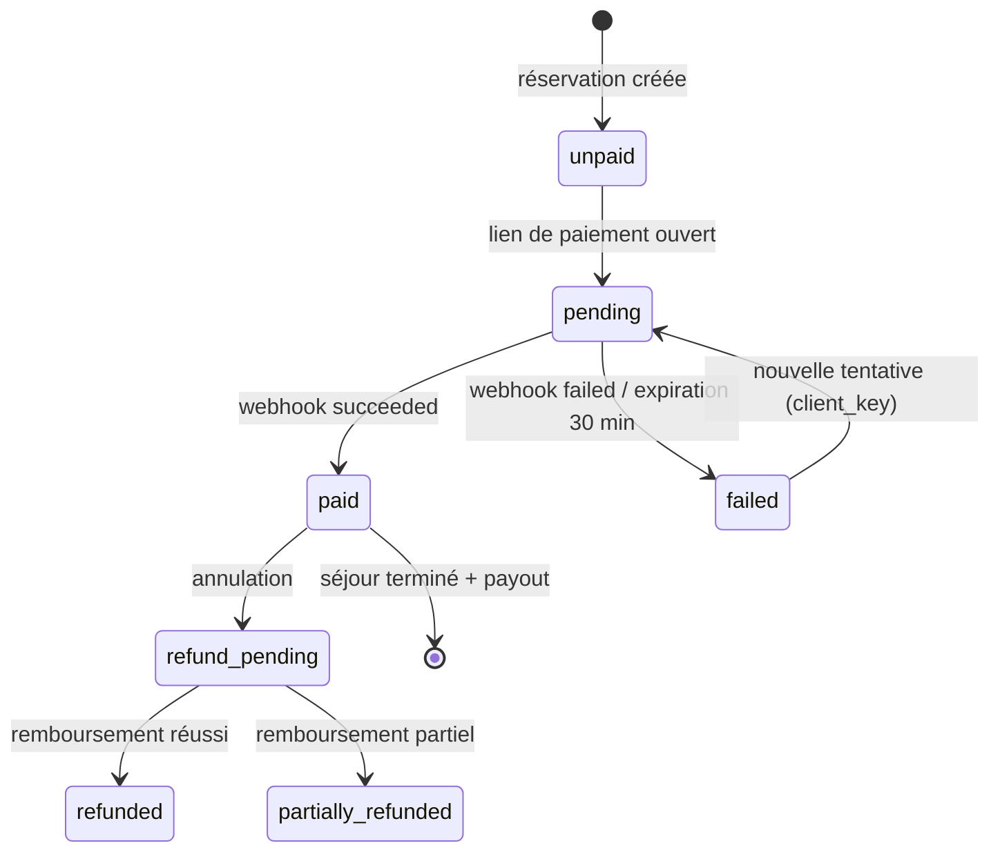
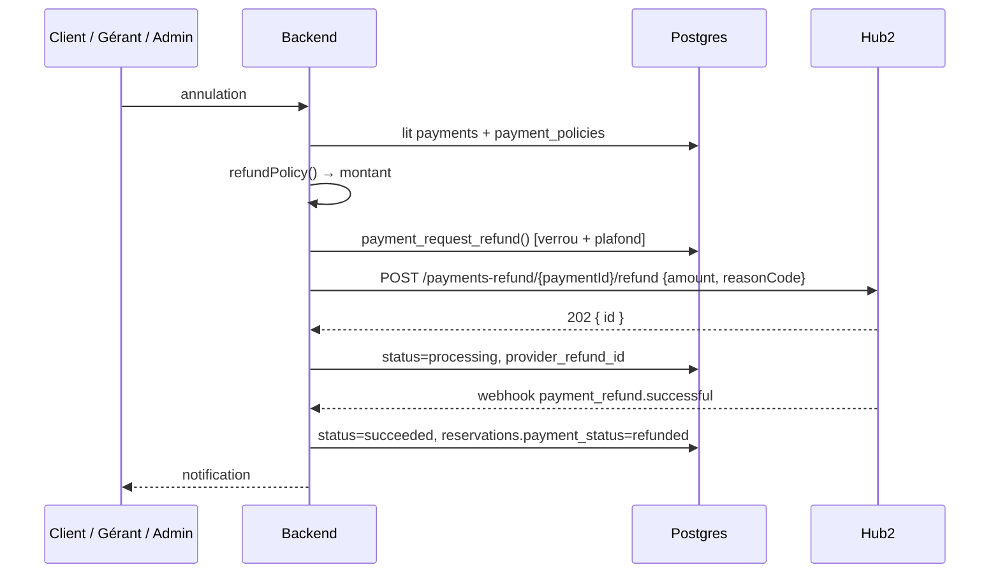

# Architecture des paiements — Hub2

> Statut : proposition d'architecture, prête à être implémentée par phases.
> Périmètre : abonnement Premium des gérants, paiement des réservations par
> les clients, remboursement en cas d'annulation, reversement aux gérants.
> Remplace FedaPay, qui ne couvrait que le Premium et ne proposait ni
> paiement de réservation ni remboursement partiel.
>
> **État au 28/10/2026** — phases 1 à 4 implémentées côté code : socle et
> webhook, Premium Hub2, réservations payées, remboursements totaux, jobs
> d'expiration (30 min / 48 h) et de réconciliation, puis reversements gérants
> (coordonnées vérifiées, job `payoutDue`, webhooks `transfer.*`). Les
> migrations `0030` à `0033` restent à appliquer sur chaque environnement.
> Phase 5 (retrait de FedaPay) à venir.

---

## 1. Objectif

Aujourd'hui, l'argent circule en dehors de la plateforme : le client paie le
gérant « selon les modalités convenues », et seul le Premium est encaissé en
ligne (FedaPay, redirection vers une page hébergée). Trois conséquences :

- les dates sont bloquées 48 h par des demandes qui ne se concrétisent pas ;
- aucun remboursement ne peut être déclenché par le code ;
- la plateforme ne peut prélever aucune commission sur les séjours.

La cible : **un seul encaissement en ligne par Hub2**, un grand livre unique,
et des remboursements/reversements pilotés par des webhooks.

---

## 2. Ce qui change, ce qui reste

| Élément | Aujourd'hui | Cible |
|---|---|---|
| Prestataire | FedaPay (SDK `fedapay`) | Hub2 (API REST, `fetch`) |
| Premium gérant | `POST /api/premium/initiate` → `payment_url` FedaPay | Payment Link Hub2 → `checkout_url` |
| Réservation client | gratuite, `statut = en_attente` | réservation + paiement total |
| Remboursement | manuel, hors code | `POST /payments-refund/{id}/refund` (partiel autorisé) |
| Reversement gérant | aucun | `POST /transfers` après séjour |
| Grand livre | `premium_transactions` (FedaPay) | `payments` (générique, multi-produits) |
| Statut réservation | `statut` seul | `statut` (décision gérant) + `payment_status` (argent) |

Ce qui ne change pas : la table `reservations`, la RPC
`create_reservation_checked`, les notifications, les écrans de liste. On
**ajoute** des colonnes et des tables, on ne réécrit pas l'existant.

---

## 3. Décisions structurantes

| # | Décision | Choix retenu | Pourquoi |
|---|---|---|---|
| D1 | Qui encaisse le loyer ? | **La plateforme encaisse tout**, puis reverse au gérant | Seule façon de rembourser automatiquement et de suivre les flux |
| D2 | Montant encaissé | **100 % du séjour** (validé) | Pas de solde à recouvrer hors plateforme |
| D3 | Devise débitée | **Devise locale Hub2** (XOF, XAF, GNF), prix de référence conservé en XOF | Hub2 refuse un PaymentIntent dans une devise non supportée par le compte pays |
| D4 | Moment du paiement | **À la demande de réservation**, pas après confirmation | Supprime le blocage de dates par des demandes fantômes |
| D5 | Confirmation gérant | Le gérant confirme/refuse une réservation **déjà payée** ; un refus déclenche un remboursement total | Le client n'avance rien sans contrepartie |
| D6 | Remboursement | **Total par défaut** (validé) ; partiel réservé aux gestes commerciaux et litiges | L'API accepte un montant, le plafond cumulé est vérifié en SQL |
| D7 | Frais Hub2 | **Plateforme** (`fees_bearer = 'platform'`) | Le client voit un prix rond ; le gérant reçoit le net annoncé |
| D8 | Reversement | Après `date_debut` + `payout_delay_hours` (24 h par défaut), commission 0 | Laisse une fenêtre pour un litige ou une annulation tardive |

### Décisions validées

1. **La plateforme encaisse la totalité du séjour.** Pas d'acompte : le client
   règle 100 % en ligne, le gérant est reversé après le séjour. C'est la seule
   configuration qui permet un remboursement total automatique.
2. **Tout remboursement est total.** Pas de décote selon la date
   d'annulation : le client récupère l'intégralité de la somme encaissée. Le
   remboursement partiel reste possible techniquement (`amount` dans l'API
   Hub2) pour les gestes commerciaux et les litiges, mais aucune règle
   automatique ne l'utilise.
3. **Commission à 0.** `commission_percent = 0` : le gérant reçoit
   l'intégralité de ce qui a été encaissé, hors frais Hub2 pris en charge par
   la plateforme (`fees_bearer = 'platform'`).

Ces trois choix sont les valeurs par défaut de la migration. Les colonnes
restent paramétrables pour ne pas imposer une migration le jour où la
commission ou l'acompte deviennent nécessaires.

---

## 4. Couverture Hub2 et devises

Relevé le 27/10/2026 sur `GET https://api.hub2.io/data/countries` et
`GET https://api.hub2.io/data/providers`.

| Marché | Devise réelle | Mobile money | Carte | En ligne |
|---|---|---|---|---|
| CI | XOF | Orange, MTN, Moov, Wave | Ecobank | ✅ |
| BJ | XOF | Moov, MTN, Celtiis | — | ✅ |
| SN | XOF | Orange, Free, Emoney, Wave | — | ✅ |
| TG | XOF | Moov, Togocell | — | ✅ |
| CM | **XAF** | Orange, MTN | — | ✅ |
| BF | XOF | Orange, Mobicash, Moov, Wave | — | ✅ |
| CG | **XAF** | MTN, Airtel | — | ✅ |
| GA | **XAF** | Airtel, Moov, Mobicash | — | ✅ |
| GN | **GNF** | Orange, MTN | — | ✅ |
| ML | XOF | Orange, Mobicash | — | ✅ |
| NE | — | non exposé | — | ❌ |
| CD | — | non exposé | — | ❌ |

Conséquences :

- **NE et CD restent hors paiement en ligne** (`online_payment_enabled =
  false`). Le front affiche « paiement en ligne bientôt disponible » et la
  réservation garde le circuit actuel. Aucune régression, aucune fausse
  promesse.
- **XAF/XOF** : parité fixe 1:1, aucun risque de change.
- **GNF** : taux flottant. `fx_rates` stocke le taux, `payments` conserve
  `amount_xof`, `amount` (GNF) et `fx_rate`. Sans taux du jour, le paiement
  est refusé (`FX_RATE_MISSING`) plutôt que facturé au hasard.
- Les opérateurs sont **lus depuis la config**, jamais codés en dur dans le
  front : un opérateur retiré par Hub2 ne doit pas casser le checkout.

---

## 5. Vue d'ensemble



Deux principes non négociables :

1. **Le backend est la seule source de vérité du montant.** Le front envoie
   un `reservation_id` / un marché, jamais un prix.
2. **Le webhook est le chemin nominal ; le polling est un secours.** Une page
   de retour peut être fermée, un webhook peut être rejoué : les deux
   convergent vers la même fonction SQL idempotente.

---

## 6. Modèle de données

Migration : `backend/supabase/migrations/0030_paiements_hub2.sql`.

### 6.1 Tables

| Table | Rôle |
|---|---|
| `payments` | Grand livre : un encaissement = une ligne, `reference` = `purchaseReference` Hub2 |
| `payment_events` | Boîte de réception des webhooks, unicité `(provider, provider_event_id)` |
| `payment_refunds` | Remboursements demandés, partiels ou totaux |
| `payment_payouts` | Reversements aux gérants (PAY-OUT) |
| `payment_policies` | Paramètres par marché : encaissement total, commission (0), délai de payout, activation en ligne |
| `fx_rates` | Conversion XOF → devise de débit (XAF, GNF) |
| `reservations` | `+ payment_status`, `payment_id`, `paid_at`, `refunded_amount` |
| `gerants` | `+ payout_method`, `payout_phone`, `payout_bank_code`, `payout_account_number`, `payout_holder_name`, `payout_verified_at` |

> Le produit « boost » n'est plus exposé par l'API (les tables `boosts`
> existent encore). La colonne `purpose` l'accepte déjà, pour une
> réactivation future sans nouvelle migration.

### 6.2 Relations



### 6.3 Règles portées par la base

- `payments.reference` est **unique** : c'est l'idempotence de bout en bout.
- `payment_events (provider, provider_event_id)` est **unique** : un rejeu de
  webhook ne produit jamais deux activations.
- `payment_claim_succeeded()` verrouille la ligne (`FOR UPDATE`), vérifie
  montant et devise, puis passe `created/pending → succeeded`. Un second
  appel renvoie `already_claimed = true` sans rien rejouer.
- `payment_request_refund()` calcule la somme déjà remboursée **sous verrou**
  et refuse au-delà du montant encaissé (`REFUND_EXCEEDS_PAYMENT`).
- `payments.fulfilled_at` matérialise « la contrepartie a été livrée »
  (jours de premium crédités, réservation marquée payée, boost activé). Une
  seule activation possible, quel que soit le nombre de webhooks.
- Aucune policy RLS : seul le service role (backend) lit et écrit, comme
  `premium_transactions`.

---

## 7. Flux A — abonnement Premium d'un gérant

### Séquence



Le webhook reste le chemin nominal. Le retour navigateur ne fait que
**confirmer** : il interroge Hub2, puis active via la même RPC atomique. Si
l'intent est introuvable (hypothèse non documentée : un Payment Link peut ne
pas propager `purchaseReference` à son intent), le backend interroge
`GET /payment-links/{id}` et retient la tentative réellement réussie
(`paymentAttempts`). `fulfilled_at` garantit qu'un webhook concurrent ne
prolonge pas deux fois.

### Règles métier

- Prix : `PREMIUM_AMOUNT` (5 000 XOF) et `PREMIUM_DURATION_DAYS` (30) restent
  des constantes serveur, comme aujourd'hui.
- Un gérant déjà premium ou déjà actif sur un autre marché est refusé avant
  création du lien (`409`), pour ne pas encaisser un paiement non activable.
- La prolongation utilise la même logique atomique que
  `activate_premium_checked` : `payments.fulfilled_at` fait office de claim.
- Si le webhook arrive après la page de succès, le polling `/api/payments/:ref`
  a déjà tranché ; le webhook renvoie `already_claimed`.

### Ce que devient `routes/premium.ts`

Il reste une **façade** :

```
POST /api/premium/initiate  → createPremiumCheckout({ market, clerkUserId, email })
GET  /api/premium/status    → inchangé (lit gerants)
POST /api/premium/confirm   → confirmPremiumPayment(reference, clerkUserId)
POST /api/premium/webhook   → supprimé (remplacé par /api/webhooks/hub2)
```

La branche FedaPay reste intacte derrière `PAYMENTS_PROVIDER=fedapay` : la
route accepte `transaction_id` (FedaPay) ou `reference` (Hub2), jamais les deux.

Le front passe de `payment_url` à `checkout_url` ; c'est le seul changement
d'interface visible.

---

## 8. Flux B — réservation d'un client

### Séquence



### Cycle de vie



`statut` (gérant) et `payment_status` (argent) sont **indépendants** :

| `statut` | `payment_status` | Sens |
|---|---|---|
| `en_attente` | `paid` | payée, en attente de décision du gérant |
| `confirmee` | `paid` | confirmée et payée |
| `annulee` | `refunded` | refus gérant ou annulation, remboursée |
| `annulee` | `unpaid` | demande jamais payée, dates libérées |

### Règles de disponibilité

- Le blocage des dates commence à la création (`en_attente`), comme
  aujourd'hui : deux clients ne peuvent pas payer la même chambre.
- **Expiration du lien : 30 minutes.** Passé ce délai sans paiement, un job
  annule la réservation (`payment_status = failed`, `statut = annulee`) et
  libère les dates. C'est plus court et plus prévisible que les 48 h
  actuelles, qui ne s'appliquent plus qu'aux réservations **payées** en
  attente de réponse du gérant.
- Réservation payée sans réponse du gérant sous 48 h → annulation +
  remboursement à 100 % (job `expirePaidPending`).

### Endpoints

| Méthode | Route | Accès | Rôle |
|---|---|---|---|
| `POST` | `/api/reservations` | public (rate-limité) | crée la réservation **et** le lien de paiement |
| `POST` | `/api/reservations/:id/payment` | public + `client_key` | régénère un lien expiré |
| `GET` | `/api/reservations/:id/payment` | public + `client_key` | état du paiement (polling) |
| `GET` | `/api/reservations/mine` | Clerk | ajoute `payment_status`, `refunded_amount` |

Le `client_key` (déjà présent, unique) sert de preuve de possession pour un
client non connecté. Aucun nouvel identifiant secret à inventer.

---

## 9. Flux C — annulation et remboursement

### Politique par défaut

**Tout remboursement est total.** Quelle que soit la date d'annulation, le
client récupère 100 % de la somme encaissée.

| Cas | Remboursement | Déclencheur |
|---|---|---|
| Le gérant refuse | **100 %** | `PATCH /reservations/:id { statut:"annulee" }` |
| Le gérant ne répond pas sous 48 h | **100 %** | job |
| Annulation client, quelle que soit la date | **100 %** | `POST /reservations/:id/cancel` |
| Annulation plateforme / chambre indisponible | **100 %** | admin |
| Lien de paiement expiré (jamais payé) | rien à rembourser | job |
| Geste commercial / litige | montant libre ≤ encaissé | admin |

Aucun barème, aucune décote : `refundPolicy.ts` renvoie toujours le montant
encaissé moins ce qui a déjà été remboursé. Le montant est **figé** dans
`payment_refunds.policy_snapshot` pour l'audit.

### Séquence



### Cas limites à traiter explicitement

| Cas | Comportement |
|---|---|
| Remboursement partiel déjà effectué | `payment_request_refund` plafonne le cumul |
| Hub2 renvoie `pending_manual` | statut `manual_required` + file d'attente admin |
| Remboursement échoué | statut `failed`, **pas** de nouvelle tentative automatique infinie : 3 essais puis alerte |
| Paiement déjà reversé au gérant | remboursement refusé côté plateforme → clawback manuel (`payment_payouts.refunded_amount`) |
| Annulation après le séjour | hors politique : `dispute` / `goodwill`, décision admin |
| Numéro mobile money fermé | Hub2 échoue → `manual_required`, contact client |

---

## 10. Flux D — reversement au gérant

1. À `date_debut + payout_delay_hours`, un job sélectionne les réservations
   `confirmee` + `payment_status = paid` sans payout.
2. `net = encaissé − commission − remboursements`.
3. Si le gérant n'a pas de destination vérifiée : payout `scheduled` mais
   bloqué, notification « renseignez votre moyen de reversement ».
4. `POST /transfers` Hub2 (`destination.type = mobile_money | bank_transfer`).
5. `transfer.succeeded` → `paid` ; `transfer.failed` → `failed` + alerte.

Prérequis opérationnel : les fonds doivent être sur le compte de transfert
Hub2. `POST /provisioning` déplace le solde du compte d'encaissement vers le
compte de transfert ; `GET /balance` permet de vérifier avant un lot de
payouts. À planifier quotidiennement.

### Implémentation (phase 4)

| Élément | Emplacement |
|---|---|
| Client Hub2 | `payments/hub2/transfers.ts` — `POST /transfers`, `GET /transfers/{id}`, recherche par `reference` |
| Service | `payments/service/payout.ts` — calcul du net, scheduling, envoi, réconciliation, coordonnées |
| Job | `payments/jobs/payoutDue.ts` — toutes les 5 min : `schedule → reconcile → process` |
| Routes gérant | `GET/PUT /api/payouts/settings`, `GET /api/payouts/mine` |
| Vérification admin | `PATCH /api/admin/gerants/:id/payout-verification` |
| Webhooks | `transfer.succeeded` / `transfer.failed` routés vers `applyTransferEvent` |
| Migration | `0033_reversements_hub2.sql` (coordonnées, snapshot destination, index d'échéance) |

Règles de sûreté :

- **Aucun transfert sans destination vérifiée** (`gerants.payout_verified_at`) :
  la ligne reste `scheduled` avec `failure_code = 'payout_details_missing'` et
  le gérant reçoit une notification `payout_details_required`. Toute
  modification des coordonnées remet `payout_verified_at` à `NULL` : la
  vérification administrateur est à refaire.
- **Claim atomique** `scheduled → processing` avant `POST /transfers` : deux
  workers ne peuvent pas envoyer le même transfert. La `reference` unique et
  l'idempotence Hub2 sont la seconde barrière.
- **`paid` est terminal** : un `transfer.failed` tardif ne rétrograde jamais un
  payout déjà payé.
- **Issue incertaine** (timeout, 5xx) : la ligne reste `processing` avec
  `failure_code = 'unconfirmed'`. La réconciliation relit le transfert par
  `provider_transfer_id` puis par `reference` ; introuvable après 1 h, la ligne
  repart en `scheduled` pour une nouvelle tentative.
- La destination est **figée au moment de l'envoi** (snapshot dans
  `payment_payouts`) : modifier ses coordonnées ensuite ne détourne pas un
  transfert déjà parti.
- Notifications : `payout_scheduled`, `payout_details_required`,
  `payout_details_verified`, `payout_paid`, `payout_failed`.

---

## 11. Contrats API

### `POST /api/payments/checkout`

```json
// requête
{ "purpose": "premium" | "booking" | "boost", "market": "CI",
  "reservation_id": "…", "boost_id": "…", "return_path": "/ci/gerant/premium/success" }

// 201
{ "reference": "PAY-2026-000123",
  "checkout_url": "https://pay.hub2.io/pl_…",
  "amount": 5000, "currency": "XOF", "amount_xof": 5000,
  "expires_at": "2026-10-27T12:30:00.000Z" }
```

Erreurs : `400` (paramètres), `401`, `403` (marché du gérant), `409`
(déjà premium / réservation déjà payée), `422` (`FX_RATE_MISSING`,
`ONLINE_PAYMENT_DISABLED`), `429`.

### `GET /api/payments/:reference`

```json
{ "reference": "PAY-2026-000123", "purpose": "booking", "status": "succeeded",
  "amount": 120000, "currency": "XOF", "paid_at": "…",
  "refunds": [{ "amount": 60000, "status": "succeeded" }],
  "reservation": { "id": "…", "statut": "en_attente", "payment_status": "partially_refunded" } }
```

Accessible au payeur (Clerk) ou, pour une réservation anonyme, avec
`client_key`.

### `POST /api/reservations/:id/cancel`

```json
// 200
{ "statut": "annulee", "payment_status": "refund_pending",
  "refund": { "amount": 120000, "percent": 100, "reason": "client_cancellation" } }
```

### `POST /api/reservations/:id/refund` (gérant/admin)

```json
{ "amount": 60000, "reason": "gerant_refusal", "details": "Chambre indisponible" }
```

`amount` est optionnel : sans lui, la politique s'applique. Le plafond reste
vérifié en SQL.

### `GET/PUT /api/payouts/settings` (gérant)

```json
// PUT
{ "method": "mobile_money", "phone": "+2250700000000", "provider": "orange",
  "holder_name": "Awa Kouassi" }

// 200 (les champs bancaires sont null en mobile money)
{ "method": "mobile_money", "phone": "…", "provider": "orange",
  "bank_code": null, "bank_name": null, "account_number": null,
  "holder_name": "Awa Kouassi", "verified": false,
  "verified_at": null, "missing_fields": [] }
```

`verified` n'est vrai que si les coordonnées sont **complètes et validées par
un administrateur**. `missing_fields` liste ce qu'il reste à saisir. Aucune clé
ni identifiant Hub2 n'est renvoyé.

### `GET /api/payouts/mine` (gérant)

```json
[{ "id": "…", "reference": "OUT-…", "reservation_id": "…",
   "gross_amount": 150000, "commission_amount": 0, "refunded_amount": 0,
   "net_amount": 150000, "currency": "XOF", "status": "paid",
   "scheduled_for": "…", "paid_at": "…", "failure_code": null }]
```

Statuts exposés : `scheduled`, `processing`, `paid`, `failed`, `canceled`.
`failure_code = 'payout_details_missing'` signale un payout bloqué faute de
coordonnées vérifiées ; `'unconfirmed'` un transfert en cours de vérification.

### `PATCH /api/admin/gerants/:id/payout-verification`

```json
{ "verified": true }
```

Réservé aux administrateurs. `verified: false` révoque la destination (les
payouts à venir repassent en `payout_details_missing`).

### `POST /api/webhooks/hub2`

- Corps brut conservé (`rawBody`), comme pour FedaPay.
- Réponse **2xx immédiate** (< 5 s) après vérification de signature et
  insertion dans `payment_events` ; le traitement métier peut suivre en
  asynchrone.
- Un événement inconnu est stocké puis ignoré (`processed_at` renseigné,
  `processing_error = 'unsupported_event'`).

---

## 12. Webhooks

### Événements à écouter

| Événement | Effet |
|---|---|
| `payment_intent.succeeded` | claim du paiement + activation |
| `payment_links.paid` / `payment_links.completed` | idem (le lien porte `purchaseReference`) |
| `payment_intent.payment_failed` | `payments.status = failed` |
| `payment_intent.action_required` | `requires_action` (USSD en attente) |
| `payment_intent.processing` | `pending` |
| `payment_links.expired` / `payment_links.closed` | `expired` / `canceled` |
| `payment.succeeded` / `payment.failed` | reconnus ; sans `purchaseReference` ils sont tracés `missing_reference` |
| `payment_refund.successful` | `payment_refunds.status = succeeded` |
| `payment_refund.failed` | `failed` + alerte |
| `payment_refund.pending_manual` | `manual_required` + file admin |
| `transfer.succeeded` / `transfer.failed` | statut du payout |

Hub2 recommande **un webhook par événement** pour qu'une désactivation n'en
coupe pas d'autres. Compromis retenu : **un seul endpoint**
(`POST /api/webhooks/hub2`), dont le champ `type` route le traitement. Un seul
secret à gérer, une seule URL à déclarer dans le dashboard, et l'ajout d'un
événement ne demande aucun redéploiement de configuration côté Hub2.

Le endpoint est monté **avant** l'`express.json` global, avec un
`express.json({ verify })` dédié (limite 256 Ko) : la signature porte sur le
corps brut, qu'une re-sérialisation invaliderait.

### Signature

En-tête : `Hub2-Signature: s1=…,s0=…`.

```
attendu = HMAC_SHA256(secret, s0 + "." + rawBody)
```

À confirmer avec Hub2 avant la mise en production (l'algorithme exact n'est
pas publié). Le code doit :

- comparer en temps constant (`crypto.timingSafeEqual`) ;
- refuser un `s0` de plus de 5 minutes (anti-rejeu) ;
- journaliser `event.id` et `event.type` sans jamais logger le corps complet
  (données personnelles).

### Idempotence et ordre

Les webhooks peuvent arriver **dans le désordre** (`succeeded` avant
`processing`). Le traitement ne fait jamais de mise à jour naïve :

```
si status actuel ∈ {succeeded, refunded} → ignorer une régression
sinon appliquer la transition
```

`payment_events` sert de journal et de file de reprise : un événement dont le
traitement échoue garde `processed_at = NULL` et est repris par le cron.

---

## 13. Sécurité

| Risque | Contre-mesure |
|---|---|
| Client qui falsifie le montant | montant recalculé serveur depuis `rooms.price_num` + durée ; jamais lu du corps |
| Rejeu de webhook | signature + `(provider, event_id)` unique + claim SQL |
| Rejeu de requête de paiement | `reference` unique + `client_key` unique sur les réservations |
| Énumération de transactions | `GET /payments/:reference` exige Clerk ou `client_key` ; rate-limit dédié |
| Fuite de clé API | clé uniquement côté serveur ; le front ne voit que `checkout_url` |
| Redirection post-paiement vers un domaine tiers | `successUrl`/`failureUrl` construits depuis `APP_PUBLIC_URL`, jamais depuis `Origin` |
| Double remboursement | `payment_request_refund` sous verrou |
| Webhook volumineux / lenteur | limiteur 60/min, réponse 2xx immédiate, traitement découplé |

---

## 14. Organisation du code

```
backend/src/payments/
  types.ts                 # PaymentProvider, PaymentStatus, RefundStatus…
  config.ts                # marchés → devise, opérateurs, activation
  hub2/
    client.ts              # fetch + headers + timeout + retry idempotent
    paymentLinks.ts        # POST /payment-links
    paymentIntents.ts      # GET /payment-intents/{id}
    refunds.ts             # POST /payments-refund/{id}/refund, GET …/status
    transfers.ts           # POST /transfers, GET /transfers/{id}
    webhooks.ts            # vérification signature + parsing
    mapping.ts             # statuts Hub2 → statuts internes
  service/
    checkout.ts            # createCheckout, syncFromProvider
    applyEvent.ts          # transition idempotente
    refunds.ts             # politique + appel Hub2 + persistance
    payout.ts              # calcul du net + transfert + réconciliation + coordonnées
    fx.ts                  # taux du jour, arrondi
    policy.ts              # refundPolicy()
  jobs/
    expireUnpaid.ts        # liens expirés → annulation
    expirePaidPending.ts   # 48 h sans réponse → remboursement
    reconcile.ts           # polling des paiements pending
    payoutDue.ts           # reversements dus
  routes/
    payments.ts            # /api/payments/*
    webhooks.ts            # /api/webhooks/hub2/*
    refunds.ts             # /api/reservations/:id/refund
    payouts.ts             # /api/payouts/* (gérant)
```

`config/fedapay.ts` et `config/fedapayHttp.ts` sont supprimés en phase 5.
`smoke/fedapayRiskTests.*` également.

### Frontend touché

| Fichier | Changement |
|---|---|
| `src/lib/api.ts` | `apiPremium.initiate` → `{ reference, checkout_url }` ; nouveaux `apiPayments` |
| `pages/gerant/PremiumPage.tsx` | redirection vers `checkout_url` |
| `pages/gerant/PremiumSuccessPage.tsx` | polling `GET /api/payments/:reference` au lieu de `/premium/confirm` |
| `pages/RoomDetailMaq7.tsx` | après `addReservation`, redirection checkout |
| `pages/ClientReservationPage.tsx` + `client-compte/ReservationCard.tsx` | badge payé/remboursé, annulation avec aperçu du remboursement |
| `pages/gerant/ReservationsPage.tsx` | badge paiement, action « Rembourser » |
| `pages/gerant/ReversementsPage.tsx` | coordonnées de payout (mobile money / virement), statut de vérification, historique |
| `components/AdminGerantDrawer.tsx` | validation/révocation des coordonnées de payout par l'admin |
| `lib/api.ts` | `apiPayouts` (settings + liste), types `PayoutData` / `PayoutSettingsData` |
| `components/contact/data.ts` | « FedaPay » → « Hub2 » |

Nouvelle route : `/:market/reservation/:id/paiement` (retour Hub2, polling,
bouton « réessayer »).

---

## 15. Configuration

```dotenv
# ── Hub2 ──
HUB2_ENV=sandbox                 # sandbox | live
HUB2_API_KEY=
HUB2_MERCHANT_ID=
HUB2_WEBHOOK_SECRET=whsec_…
HUB2_TIMEOUT_MS=15000
HUB2_PAYMENT_LINK_TTL_MINUTES=30

# Phase 1 : false = mode observation. Les webhooks sont stockés dans
# payment_events et marqués « observation_mode », rien n'est activé.
PAYMENTS_APPLY_EVENTS=false

# Bascule progressive (phase 2) : fedapay | hub2
PAYMENTS_PROVIDER=hub2

# URL publique (déjà présente) : base des successUrl/failureUrl
APP_PUBLIC_URL=https://app.linkhoo.com
```

`HUB2_ENV` est envoyé dans l'en-tête `Environment` de chaque appel. Une clé
sandbox avec `HUB2_ENV=live` échoue à l'authentification : `getHub2Config()`
lève `HUB2_SANDBOX_IN_PRODUCTION` si `NODE_ENV=production` et
`HUB2_ENV=sandbox`.

`HUB2_WEBHOOK_SECRET` absent ne bloque pas le démarrage : le webhook répond
`503` et refuse tout événement. C'est volontaire — un endpoint qui accepterait
des webhooks non signés serait pire qu'un endpoint indisponible.

---

## 16. Migration FedaPay → Hub2

### Phase 0 — Validation sandbox (1–2 jours)

- Créer un Payment Link en CI (XOF) et en CM (XAF) ; vérifier le montant.
- Vérifier la signature d'un webhook réel, l'algorithme `s1/s0`.
- Créer un remboursement **partiel** et vérifier les webhooks
  `payment_refund.*`.
- Créer un Transfer vers un numéro sandbox Hub2.
- Confirmer la couverture NE/CD (probablement non) et le délai de settlement.

**Critère de sortie** : un paiement CI de bout en bout, un remboursement
partiel, un payout, tous tracés en base.

### Phase 1 — Socle (schéma + client + webhook)

- Appliquer `0030_paiements_hub2.sql`.
- `payments/hub2/client.ts`, `mapping.ts`, `webhooks.ts`.
- Endpoint webhook en **mode observation** : il stocke les événements mais
  n'active rien (`APPLY_EVENTS=false`). Permet de comparer avec le réel.
- Tests unitaires : mapping, signature, idempotence.

### Phase 2 — Premium (bascule du seul flux existant)

- `payments/service/checkout.ts` + façade `routes/premium.ts`.
- `PAYMENTS_PROVIDER=hub2` en sandbox puis en production.
- FedaPay reste en place derrière `PAYMENTS_PROVIDER=fedapay` (rollback en
  une variable d'environnement).
- Mise à jour `PremiumPage`, `PremiumSuccessPage`, tests.

**Critère de sortie** : 10 abonnements réels encaissés, 0 activation
manquante, webhook et polling cohérents.

### Phase 3 — Réservations payées + remboursements

- `POST /api/reservations` crée le lien ; pages de retour ; polling.
- Jobs d'expiration (30 min / 48 h).
- Politique de remboursement + endpoints.
- Bascule marché par marché via `payment_policies.online_payment_enabled` :
  commencer par **CI**, puis BJ/SN/TG/BF/ML, puis CM/CG/GA (XAF), puis GN
  (GNF). NE et CD restent en paiement direct.

**Critère de sortie** : 50 réservations payées, 5 annulations remboursées
correctement, aucune date bloquée au-delà de 30 min sans paiement.

### Phase 4 — Reversements

- Collecte des coordonnées de payout des gérants (écran + vérification).
- Job `payoutDue`, `POST /transfers`, webhooks.
- Provisioning quotidien + contrôle `GET /balance`.

**État : implémenté côté code** — migration `0033_reversements_hub2.sql`,
`hub2/transfers.ts`, `service/payout.ts`, job `payoutDue`, routes
`/api/payouts/*`, vérification admin (drawer gérant) et écran gérant
`ReversementsPage`. Restent à faire : appliquer la migration, provisionner le
compte de transfert Hub2 et recruter les gérants pilotes.

### Phase 5 — Décommissionnement FedaPay

- Supprimer `fedapay` de `package.json`, `config/fedapay*.ts`,
  `smoke/fedapayRiskTests.*`, les variables `FEDAPAY_*`.
- `premium_transactions` reste en **lecture seule** (historique comptable).
- Retirer le SDK du lockfile ; mettre à jour la CI.

### Rollback

| Phase | Retour arrière |
|---|---|
| 2 | `PAYMENTS_PROVIDER=fedapay` (redéploiement sans migration) |
| 3 | `online_payment_enabled=false` par marché (les réservations repassent en paiement direct) |
| 4 | Payouts `scheduled` → `canceled`, traitement manuel |

Aucune phase ne supprime de données. `payments` et `premium_transactions`
coexistent jusqu'à la phase 5.

---

## 17. Tests

### Unitaires (Vitest)

- `mapping.test.ts` : chaque statut Hub2 → statut interne, y compris
  `action_required`, `canceled`, `expired`.
- `webhooks.test.ts` : signature valide/invalide, timestamp trop vieux,
  corps brut, événement inconnu.
- `policy.test.ts` : remboursement total quel que soit le délai, plafond
  cumulé, arrondis.
- `fx.test.ts` : XAF parité, GNF, taux absent → erreur, arrondi au franc.
- `applyEvent.test.ts` : `succeeded` puis `processing` (désordre) ne
  rétrograde pas ; deux `succeeded` → une seule activation.
- `payout.test.ts` : calcul du net, blocage sans coordonnées vérifiées, claim
  atomique, issue incertaine (`unconfirmed`), `paid` terminal.
- `transfers.test.ts` / `payouts.test.ts` : payload Hub2, contrat des routes
  gérant, refus d'un gérant non autorisé.

### Base de données

- `payment_claim_succeeded` : double appel → `already_claimed`.
- `payment_request_refund` : cumul > encaissé → exception ; concurrence
  (deux sessions) → une seule passe.
- Contraintes : `reference` dupliquée, `net_amount` incohérent.

### Intégration

- `POST /api/reservations` → lien créé, montant recalculé, `client_key`
  idempotent.
- Webhook rejoué 3 fois → un seul `paid_at`, une seule notification.
- Annulation à J-5, J-10, J-1 → **100 %** dans tous les cas.
- Gérant refuse → 100 % + notification client.

### Sandbox Hub2 (contrat)

- Payment Link CI/CM/GN, montant minimum 500.
- Remboursement partiel puis total (plafond).
- Transfer mobile money sandbox.
- Ces tests tournent hors CI (secrets), via `npm run test:payments:sandbox`.

### E2E Playwright

- Premium : clic → checkout Hub2 (sandbox) → retour → badge premium actif.
- Réservation : formulaire → checkout → retour → statut « payée ».
- Annulation client → écran « remboursement en cours » → « remboursée ».

---

## 18. Observabilité

| Indicateur | Seuil d'alerte |
|---|---|
| Taux de succès paiement par pays/opérateur | < 80 % sur 1 h |
| Webhooks en échec (`processed_at IS NULL` > 10 min) | > 5 |
| Paiements `pending` > 15 min | > 10 |
| Remboursements `failed` / `manual_required` | > 0 |
| Payouts `failed` | > 0 |
| Écart réconciliation (Hub2 vs DB) | > 0 |

Logs structurés : `{ reference, provider, purpose, status, market, event_id }`.
**Jamais** de numéro de téléphone complet ni de nom dans les logs.

---

## 19. Risques et questions à poser à Hub2

| # | Risque | Action |
|---|---|---|
| R1 | Algorithme de signature non publié | Faire confirmer `HMAC(s0 + "." + body)` par le support avant la phase 2 |
| R2 | Pas d'en-tête d'idempotence documenté sur `POST /payment-links` | Toujours chercher par `purchaseReference` avant de recréer ; `reference` unique en base |
| R3 | NE et CD non couverts | Confirmer par écrit ; sinon fallback paiement direct, ou second prestataire plus tard |
| R4 | Devise GNF flottante | Source de taux quotidienne + alerte si taux > 24 h |
| R5 | Remboursement mobile money vers un numéro fermé | File `manual_required` + procédure support |
| R6 | Délai de settlement inconnu | Nécessaire pour calibrer `payout_delay_hours` et le provisioning |
| R7 | Plafonds par opérateur (montant max) | Récupérer les limites via `/data/providers` ou le support ; plafonner l'acompte |
| R8 | Litige / chargeback carte | Procédure de contestation + gel du payout |

---

## 20. Checklist de démarrage

- [x] Valider D1 (la plateforme encaisse tout) et D2 (100 % du séjour).
- [x] Fixer `commission_percent` à 0.
- [x] Décider que tout remboursement est total.
- [ ] Obtenir les clés sandbox + le secret webhook.
- [ ] Confirmer la signature et la couverture NE/CD avec Hub2.
- [ ] Appliquer les migrations `0030` à `0033`.
- [x] Implémenter `payments/hub2/client.ts` + tests de signature.
- [x] Brancher le webhook (mode observation disponible via `PAYMENTS_APPLY_EVENTS`).
- [ ] Basculer le Premium en sandbox.
- [ ] Ouvrir les réservations payées sur la CI uniquement (via `payment_policies`).
- [x] Implémenter les jobs d'expiration (30 min / 48 h) et de réconciliation.
- [x] Implémenter les reversements : job `payoutDue`, `POST /transfers`, webhooks `transfer.*`, écran gérant.
- [ ] Vérifier en sandbox un transfert mobile money et un virement, puis provisionner le compte de transfert.
- [ ] Recruter 2–3 gérants pilotes pour les payouts.
